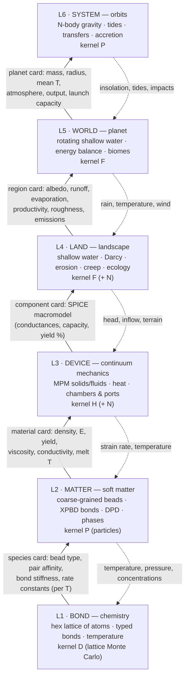

# The physics ladder: a multi-scale hex world in 4–7 levels

This is a theory note, not a plan. It does three things:

1. Catalogues the kinds of physics a multi-scale game could draw on.
2. Proposes a ladder of levels from molecules up to orbits.
3. Picks GPU and differentiable engines for each level.

The engine status was surveyed on 2026-11-17.

**The core idea.** One cell at level *k+1* is a sealed, characterized board
at level *k*. The player or agent plays a full hex board at each level.
When a board is "done", it is probed and reduced to a *card*: a handful of
numbers that the level above uses as its local rules. The project has
already built and measured this loop for flow and chemistry:

- ports and the SPICE loop (ADR 0002);
- Seal & ascend on `docs/ascent.html`;
- a four-rung chain at about 1% error, with no compounding across rungs
  (concept `hierarchical-spice-scaling`).

The ladder generalises that loop: the *physics* changes at each rung, not
just the resolution.

---

## 1. The catalogue: physics families by solver kernel

Every family below reduces to one of five computational kernels. That
reduction matters more than the list itself, because a game with
5 kernels is buildable and a game with 15 engines is not.

| Kernel | What it computes | Physics families it covers |
|---|---|---|
| **D: discrete lattice** (Monte Carlo / CA) | Site states, swaps and rewrites at a temperature | Bonding chemistry, lattice gas and FHP, Ising and phase ordering, falling sand, creep and fire spread, crystal growth |
| **P: particles** (pair forces plus bonds) | Positions and velocities with neighbour lists | Molecular dynamics (Lennard-Jones, harmonic bonds), coarse-grained and DPD beads, XPBD lattice bodies, granular DEM, active matter (Vicsek), **N-body gravity** (same kernel, 1/r force) |
| **H: hybrid particle–grid** (MPM, PIC) | Particles carry material and history; a grid solves momentum | Elasticity, plasticity, fracture, sand, snow, mud, fluids, melting: any constitutive law plugged in per particle |
| **F: lattice fields** (stencil PDEs) | Scalar or vector fields on cells | Diffusion and heat, reaction–diffusion (Turing, Gray-Scott, Brusselator), Darcy and porous flow, shallow water (pipe model), erosion (stream power), population ecology, energy-balance climate, waves and acoustics, electrostatics |
| **N: networks** (lumped graph, Kirchhoff) | Node potentials and edge fluxes | Circuits, pipe networks, SPICE macromodels of tiles, food webs, trade and logistics. **This is the universal bridge format.** |

One family is a special case: **momentum-carrying fluids**, namely
incompressible Navier–Stokes, D2Q7 lattice Boltzmann, and rotating
shallow water. They run on the field kernel but behave differently.
Inertia destroys scale separation, so these are the hardest physics to
coarse-grain (concept `foundry-testbed-physics`).

The full catalogue, roughly from small to large, with what the game
keeps of each:

| Physics | Real description | Game simplification | Kernel |
|---|---|---|---|
| Quantum and electronic structure | Schrödinger, DFT | **Dropped.** Valence = number of bond slots; bonding = affinity matrix | none |
| Chemical bonding | Bond order, reactive force fields | Typed bonds on the 6 hex edges, with energies and an activation barrier | D |
| Statistical mechanics | Boltzmann ensembles, entropy | A temperature knob drives Metropolis/Kawasaki swaps | D |
| Reaction kinetics | Mass action, Arrhenius, catalysis | Rate constants measured at level 1 and used at levels 3–4 | D → F |
| Molecular dynamics | Lennard-Jones, Coulomb, bonded terms | Soft pair forces plus bonds, Langevin thermostat | P |
| Soft matter | Polymers, colloids, self-assembly, phase separation | Coarse-grained (DPD) beads, Cahn–Hilliard as the field limit | P / F |
| Solid mechanics | Elasticity, plasticity, fracture | Material card → MPM constitutive law | H |
| Rigid bodies and mechanisms | Newton–Euler, contact, joints | Optional (Jax2D); the stiff limit of elasticity | P |
| Fluids, viscous | Navier–Stokes | MPM fluid or D2Q7 LBM at device scale | H / F |
| Porous and groundwater flow | Darcy, Richards | Already built: Foundry, ports | F |
| Heat transfer | Conduction, convection, radiation | Diffusion field plus advection; radiation as a sink term | F |
| Electromagnetism | Maxwell | Lumped circuits only, as a networks layer; waves dropped unless a level wants them | N |
| Surface hydrology | Shallow water, sediment transport | Pipe model plus stream-power erosion (Eulerian gym) | F |
| Ecology | Lotka–Volterra, reaction–diffusion populations | Creep and species as reacting fields | F |
| Atmosphere and climate | Rotating shallow water, radiative balance | Coriolis shallow water plus 1-layer energy balance (ice–albedo bistability) | F |
| Tectonics | Mantle convection, plates | Slow rigid plates as labelled cell regions, or dropped | D / F |
| Orbital mechanics | N-body gravity, tides | Direct N-body for at most a few hundred bodies, symplectic leapfrog | P |
| Stellar and cosmological | Fusion, structure formation | Optional top rung: particle-mesh gravity; a star's card = element yields | P / F |

**The structural insight.** The ladder alternates between kernel types,
just as real physics does:

- discrete atoms become particles;
- particles become continua;
- continua become landscapes;
- a whole planet becomes a particle again.

Levels 1, 2 and 6 can share one particle kernel with a different force
law, and levels 4 and 5 can share one field kernel. Engineering cost
scales with the number of kernels, not the number of levels.

---

## 2. The ladder (six levels)

Solid arrows go **up**: sealed boards become cards (parameters). Dotted
arrows (**deferred by ADR 0003**: cards go up only for now) would go **down**: the level above imposes boundary conditions (forcing)
on a lower board when it is re-entered. Coupling crosses levels *only*
through cards and boundary conditions, which keeps every level a
fixed-shape environment.

### L1 · BOND: chemistry

- **World.** A hex lattice where each cell is an atom of one of about
  6–8 element types. Its 6 edges are potential bonds. A symmetric
  affinity matrix gives each bond its energy and breaking threshold; this
  extends the existing `bond-affinity-chemistry` concept.
- **Physics.** Thermal agitation is parallel Metropolis/Kawasaki swaps.
  The triangular lattice of cell centres is 3-colourable, so 3 sublattice
  half-steps make it fully parallel with a fixed computation graph.
  Reactions are bond rewrites over an activation barrier. Catalysts are
  sites that lower the barrier.
- **Verbs.** Place and remove atoms, set the local temperature, template
  a catalyst, and harvest products.
- **Card up (species).** For each stable motif:
  - size and shape;
  - effective pair affinity with the other species;
  - bond stiffness;
  - binding energy;
  - Arrhenius rate constants for its reactions;
  - which phase it forms at each temperature.

  Cards are tabulated **per temperature bucket**. Coarse-grained
  potentials are state-dependent (the known transferability problem of
  force matching), and tabulating per bucket is the cheap fix.
- **Engine.** Custom JAX lattice Monte Carlo, about 150 lines. The
  off-lattice alternative is JAX-MD with Lennard-Jones plus bonds
  (v0.2.29, 2026-06; active; Apache-2.0).
- **Gradients.** None, because Monte Carlo is discrete. Use PPO or DQN.

### L2 · MATTER: soft matter and materials

- **World.** Each particle is one L1 species, a coarse-grained bead.
  This is where the **existing Lagrangian track lives**: XPBD point
  masses on a hex lattice, with agents that push, glue and unglue their 6
  edges. Add DPD soft forces and a Langevin thermostat so that phases
  emerge: crystal, glass, polymer, liquid and gas.
- **Physics.** Self-assembly, phase separation, melting and cracking.
- **Verbs.** Build bodies and structures, mix and anneal, run
  body-locomotion RL (the original curriculum).
- **Card up (material).** Virtual lab tests produce the material card:
  - a tensile test gives the modulus and yield strength;
  - shear (NEMD or Green–Kubo) gives viscosity;
  - a heat-flux probe gives conductivity;
  - density and melting temperature come from equilibrium runs.

  This is the same probe-and-fit pattern as SPICE characterization.
- **Engine.** Custom JAX XPBD (already designed) plus JAX-MD's
  neighbour-list machinery for off-lattice beads. The escape hatch is
  Newton's XPBD/VBD solvers through Warp FFI.
- **Gradients.** Partial. Soft forces are differentiable; glue and
  unglue are discrete. Use PPO for agents and gradients for *material
  design* ("which bead mix gives E = x?").

### L3 · DEVICE: continuum mechanics

- **World.** A Foundry tile scaled up: chambers, ports, pumps, reactors
  and mechanisms. Materials from L2 cards fill cells.
- **Physics.** MPM is the natural engine here because **the MPM
  interface *is* the bridge**: each particle carries a constitutive law,
  and the L2 material card supplies its parameters. One solver covers
  solids, sand, mud, fluids and melting. Heat runs as a diffusion field.
  Ported flow and chemistry already exist.
- **Card up (component).** The SPICE macromodel already shipped:
  15 linear probes give conductances, capacity and yield, at 3.5%
  board error.
- **Engine.** No maintained JAX MPM library exists. A custom 2D MLS-MPM
  is about 300 lines of JAX; the JAX-MPM paper (arXiv 2507.04192) has no
  code but serves as a reference design. The escape hatch is Newton's
  `SolverImplicitMPM` through `wp.jax_callable`, which now supports
  `vmap` with buffers sized for the whole batch up front.
- **Gradients.** Yes. DiffTaichi proved MPM differentiable. This is the
  best level for SHAC/AHAC-style training and for inverse design of
  components.
- **Top-down (ADR 0003).** No gravity in the plane. Devices are driven
  by pressure and pumps, actuation, thermal expansion, and material that
  agents push. Validate early that MPM without gravity still produces
  legible, interesting devices.

### L4 · LAND: landscape (exists)

- **World.** The Eulerian gym, terrain v2 and Ascent: pipe-model
  shallow water, Darcy groundwater, stream-power erosion, creep and fire
  CA, D2Q7 wind, reacting richness fields, and ecology as reacting
  populations. L3 components are placed as macromodels.
- **Card up (region).** Albedo, runoff coefficient, evapotranspiration,
  biological and industrial productivity, roughness, and emissions.
- **Engine.** Already custom JAX/JS. Exponax and JAX-CFD are useful only
  as validation references, because they use square or periodic grids.
- **Gradients.** Yes, and the dynamics are smooth. This is the most
  gradient-friendly level.

### L5 · WORLD: planet and climate

- **World.** A planet grid. A geodesic Goldberg grid (10n²+2 cells, 12
  pentagons) is the honest choice. A flat hex board with wraparound is
  the cheap one and keeps the shared hex module unchanged.
- **Physics.**
  - Rotating shallow water: Coriolis gives jets and cyclones.
  - A 1-layer energy balance with latitude-dependent insolation,
    greenhouse forcing and ice–albedo feedback gives real bistability:
    snowball versus temperate, which a player can tip.
  - Moisture transport and precipitation.
  - Optionally, slow plates as labelled regions.
- **Card up (planet).** Mass, radius, mean temperature, atmosphere,
  habitability, and output and launch capacity.
- **Engine.** Custom JAX on the shared field kernel. NeuralGCM and its
  Dinosaur core are differentiable JAX but far too heavy to run per
  environment; use them, if at all, as an offline reference.
- **Gradients.** Short horizons only, because weather is chaotic.

### L6 · SYSTEM: orbits

- **World.** Planets, moons and asteroids as particles carrying L5
  cards, around one or more stars. **This uses the same particle kernel
  as L1/L2 with a 1/r potential.** The hex lattice is a UI and
  spatial-index layer here, not the physics: orbital mechanics is not
  lattice physics, and the note does not pretend it is.
- **Physics.** Symplectic leapfrog, tides as dissipation, collisions as
  mergers (accretion), and transfer orbits costed in Δv.
- **Engine.** About 50 lines of JAX direct O(N²) for N up to a few
  hundred; diffrax if adaptive integration is ever needed. pmwd/JaxPM
  only matter at cosmological N.
- **Gradients.** Excellent for short-horizon trajectory design
  (transfer planning); useless at long horizons because of chaos.

### Optional L7 · STAR, which closes the loop

Add a stellar or galactic rung (particle-mesh gravity, star formation as
a sub-grid recipe). Its card is **element yields**, which set L1's
element palette. Stars forge the atoms of level 1, so the ladder becomes
a cycle rather than a column, and a new game can start from the
chemistry a previous player's stars produced.

### Variants

- **4 levels (minimum viable).** MATTER (L1 and L2 merged: bonded
  particles with affinity is exactly the Lagrangian track) → DEVICE →
  LAND → SYSTEM. Climate collapses into the region card by summing
  regions directly into a planet card. This needs 3 kernels: P, H and F,
  plus N for cards.
- **6 levels** as above. This is the recommended target. It needs 4
  kernels: D, P, H and F, plus N.
- **7 levels** with STAR. This needs no new kernel: particles plus a
  particle-mesh grid.
- **Life spine instead of physics spine.** Replace WORLD → SYSTEM with
  CELL → ORGANISM → ECOSYSTEM riding on L2–L4, Spore-like but derived
  rather than separate rulesets. Both spines share L1–L4.

---

## 3. Where bridges hold and where they break

The project's own measurements generalise into one rule:

> **A bridge needs extra coarse state exactly when the fine level carries
> memory that the mean does not.**

The evidence for the rule comes from four measured results:

- Diffusion, Darcy flow and bilinear chemistry lump well. The flow chain
  ran 4 rungs at about 1% error with no compounding.
- Synchronized oscillators lump well.
- Dephased oscillators do not: the lumped tile reported oscillation 5×
  too strong at 40% too low a frequency. The fix was phase state, not a
  smarter map (concept `oscillatory-closure-limits`).
- Fast reactions need covariance closure (concept
  `reaction-closure-damkohler`).

Applied to each rung:

| Bridge | Expected quality | The memory that breaks it | Fix |
|---|---|---|---|
| L1 → L2 | Medium | Temperature and composition dependence of effective potentials | Tabulate cards per temperature bucket; refit on drift |
| L2 → L3 | Good for linear response (elastic, viscous); poor for yield and fracture | Plastic history, damage | An internal-state variable per MPM particle (standard plasticity); that is the mechanics analogue of oscillator phase |
| L3 → L4 | **Measured good** (3.5% board error, no compounding) | Oscillations, inertia | Phase state; keep momentum fluids sealed inside devices |
| L4 → L5 | Good on averages | Weather variance | Card carries a mean and a variance; treat weather as a noise term |
| L5 → L6 | Trivial (a planet is a point mass plus a card) | None that matters | none |

**Design rules that follow:**

1. **Seal & ascend is the bridge.** Nothing ascends until it is sealed
   and characterized. That is honest RVE homogenization and is already
   built.
2. **Cards go up and boundary conditions come down.** There is no other
   cross-level coupling.
3. **Lower levels freeze while unvisited.** Revisiting re-simulates them
   under the current boundary conditions. The adaptive-surrogate-fallback
   (ISAT trust region) flags any card used outside its validity region.
4. **Inaccuracy is surfaced, not hidden.** Card drift is a game mechanic
   (the Inspector concept). Audit oscillatory and chaotic levels on
   statistics (amplitude, frequency, climate), never on pointwise state.
5. **Physical scale is compressed.** Real levels are 10³–10⁶ apart while
   a board is only about 10² cells across. The sealed board is a
   *representative element*, not a literal piece of the cell above. Say
   so in the fiction ("a sample of the material").

---

## 4. Engine landscape

Release dates were gathered from the GitHub API on 2026-11-17 unless
noted.

**The 2026 landscape in brief.** The momentum is Warp-based:

- Newton v1.8.0 (2026-11-11) is a Linux Foundation project built on Warp.
- MuJoCo Warp v4.0.1 ships with MuJoCo 4.0.1.
- Genesis became `genesis-world` (v1.4.7) on its own "Quadrants"
  compiler.

The pure-JAX options are thinner and mostly research-grade; Brax is in
maintenance mode (v0.14.2, 2026-03). The key interop fact: Warp kernels
are callable inside `jax.jit`, `jax.vmap` and `lax.scan` through
`wp.jax_kernel` / `wp.jax_callable`, with backward passes available. So
Warp engines are an escape hatch rather than a fork in the stack.

| Need | Pick | Why / caveat |
|---|---|---|
| Neighbour lists, LJ, Brownian dynamics, bonds | **JAX-MD** (v0.2.29) | Native JAX, vmap, differentiable; low but real activity |
| 2D rigid mechanisms | **Jax2D / Kinetix** (Kinetix v3.0.2, 2026-09) | The only maintained native-JAX 2D, RL-designed rigid engine; MIT |
| Stiff kinetics, orbital ODEs | **diffrax** | JAX, adjoints, implicit solvers |
| MPM | **Custom 2D JAX**, with **Newton implicit MPM** through Warp FFI as backup | No maintained JAX MPM exists |
| Coarse-graining by force matching | **chemtrain** (JAX), JAX-MD examples | Status unverified this session |
| CA / reaction–diffusion reference | **CAX** (JAX, ICLR 2025) | Lenia, Flow-Lenia and NCA examples |
| PDE validation | **Exponax** (v0.2.1, 2026-11), **JAX-CFD** | Square and periodic grids only, so references, not runtime |
| Multi-physics in one scene | Genesis, Newton `SolverCoupledADMM` (experimental) | Not callable from JAX; the ladder does not need same-scene coupling anyway |

**Avoid for this project:**

- **Genesis, Isaac Lab, ManiSkill, Madrona:** not callable from JAX, and
  3D-robotics shaped.
- **MJX-Warp and MuJoCo Warp:** no autodiff, and none planned.
- **JAX-FEM:** GPL-3.0.
- **NeuralGCM:** too heavy to run per environment.
- **XLB and JAX-Fluids:** check their licences first; the GitHub API
  reports no assertion, and JAX-Fluids is reportedly non-commercial.

**Verdict.** Stay JAX-native and write about 6 small hex kernels: lattice
Monte Carlo, particles, MPM, fields, rotating shallow water, and
networks. Import JAX-MD, Jax2D and diffrax for their machinery. No
engine supports a hex lattice, every level must vmap into fleets, and the
ladder switches physics *between* environments rather than coupling it
inside one scene. That last point removes the only strong argument for
Genesis or Newton.

---

## 5. Gradients and RL

The SHAC (ICLR 2022) and AHAC (ICML 2024) evidence: differentiable
rollouts beat PPO on sample efficiency when the dynamics are smooth, and
become noisy or explode under stiff contact, chaos and discontinuities.
AHAC's adaptive horizon is most of its gain, and its results are the
authors' own experiments with no independent replication found.

| Level | Dynamics | RL default | Where gradients pay |
|---|---|---|---|
| L1 BOND | Discrete Monte Carlo | PPO / DQN | No |
| L2 MATTER | Soft forces plus discrete glue | PPO | Material design |
| L3 DEVICE | MPM, smooth-ish | SHAC/AHAC candidate | Inverse design of components |
| L4 LAND | Smooth fields | Either | **Best level for gradients** |
| L5 WORLD | Chaotic weather | PPO | Short-horizon control only |
| L6 SYSTEM | Smooth but chaotic over long horizons | PPO plus planning | Transfer-orbit design |

**The biggest gradient win is the bridges, not the policies.**
Characterization is system identification: fitting a card is regression,
and differentiable. Inverse problems such as "design the L1 species that
yields this L2 material card" are what differentiable physics is best at.

**RL framing.** Each level is its own fixed-shape, vmappable environment.
Ascending is **policy compilation**: a solved lower-level design becomes
a primitive part or action above. That is the options framework from
hierarchical RL, wearing physics. A card is a probed world model of the
level below.

**Prior art.** A thin search found none that derives upper-level rules
from lower-level physics; unverified. Spore uses separate rulesets per
stage, with only a template crossing between stages. Universe Sandbox's
zoom is camera-only on one model. Kinetix, Craftax and XLand-MiniGrid are
each single-scale. Run a proper search before claiming novelty.

---

## 6. Decisions (2026-11-17, ADR 0003)

1. **Top-down at every level.**
2. **Physics spine first.** The life spine is deferred and will merge
   later on L2–L4, so the card schema reserves an open "biological"
   block.
3. **One game.**
4. **Cards go up only for now.** With no downward coupling, each level is
   a stand-alone environment that can train under domain randomization
   over the cards it receives.
5. **Home: hexphys-rl.**
